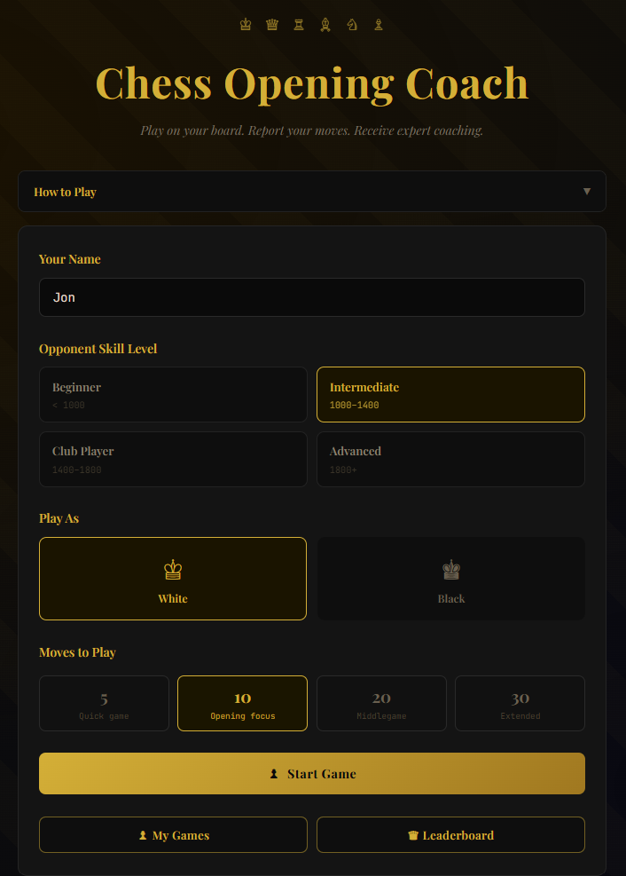

# build-app — Build Your First Web App with Claude Code

A skill for Claude Code that guides a complete beginner through building and deploying a web app,
step by step. It teaches as it builds — you finish with a working app AND an understanding of
what you built and why.

Built and used to create the [Chess Trainer app](https://chess-trainer-8tp1.onrender.com) —
a real example of what you can build using this exact process.



---

## What you'll build

By the end of this skill you'll have:

- A working web app running on your own computer
- The same app live on the internet with a public URL
- (Optional) A database so your app can save and retrieve data

You write no code. Claude Code writes it all. You direct the outcome.

**Stack:** JavaScript (Node.js) backend, plain HTML/CSS frontend. If you want to build in Python or
another language, this skill won't apply.

---

## How it works

The skill has three checkpoints — each is a genuine stopping point:

| Checkpoint | What you get |
|---|---|
| 1 | Working app on your own computer (localhost) |
| 2 | Live on the internet (GitHub + Render) |
| 3 | Stores data (Supabase database) |

At each checkpoint you choose: stop here, continue, or come back later.

---

## How to install this skill

**Not sure where to start? Ask Claude to help you.**

Open [claude.ai](https://claude.ai) in your browser and paste this message:

> "I want to install a Claude Code skill called build-app. The skill file is called SKILL.md
> and I've downloaded it from GitHub. Can you walk me through where to put it on my computer
> so I can use it in Claude Code? I'm on Windows."

Claude will walk you through each step in plain language, answer your questions, and help you
get unstuck if anything isn't clear.

---

**Or follow these steps yourself:**

**Step 1 — Download the skill**

**[Click here to download](https://github.com/alexbrown44/claude-skills/archive/refs/heads/main.zip)**

Unzip the file — you'll find a folder called `build-app` inside.

**Step 2 — Create the global skills folder**

Installing the skill globally means it's available in every project — you only do this once.

On **Windows**, create this folder path inside your user folder (`C:\Users\YourName\`):
`.claude` → `skills`

- Open File Explorer and go to `C:\Users\YourName\`
- Create a folder called `.claude`
- Open `.claude` and create a folder called `skills`

> **Note:** Folders starting with a dot (like `.claude`) are hidden by default on Windows.
> To see them in File Explorer, click **View** and tick **Hidden items**.

On **Mac**, the path is `/Users/YourName/.claude/skills/` — create it the same way in Finder,
or ask Claude to help you.

**Step 3 — Copy the skill folder**

Copy the entire `build-app` folder into the `skills` folder you just created:

```
C:\Users\YourName\        (or /Users/YourName/ on Mac)
└── .claude/
    └── skills/
        └── build-app/
            ├── SKILL.md
            └── references/
                ├── iteration-examples.md
                └── what-next.md
```

**Step 4 — Open Claude Code**

Create an empty folder for your new app, open it in Claude Code, and type `/build-app` to begin.

---

## Requirements

- [Claude Code](https://claude.ai/code) installed on your computer
- [Git](https://git-scm.com/downloads) installed on your computer (needed for Checkpoint 2)
- A free [GitHub account](https://github.com) (needed for Checkpoint 2)
- A free [Anthropic account](https://console.anthropic.com) (for the API key your app will use)
- Windows, Mac, or Linux

No coding experience required.

---

## About

This skill was built using the Chess Trainer app as the worked example throughout.
The Chess Trainer is a real app built by a non-developer using Claude Code and this exact process.

- Live app: https://chess-trainer-8tp1.onrender.com
- Source code: https://github.com/alexbrown44/chess-trainer
